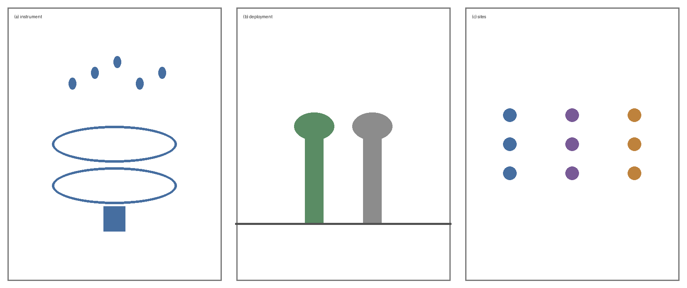
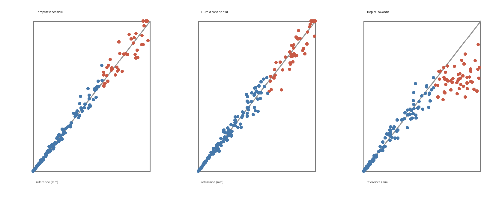

# Low-cost acoustic rain gauges: a field evaluation across three climate zones

**Authors:** Alex Rivera^1,\*^, Mei Tanaka^2^, Johan Berg^1^, Priya Nair^3^, Tomas Weber^1,†^

**Affiliations:**
^1^ Department of Environmental Engineering, Northfield Institute of Technology, Northfield, United States
^2^ Graduate School of Atmospheric Science, Kaiyo University, Yokohama, Japan
^3^ Centre for Water Resources, Deccan University, Pune, India

**Correspondence:** ^\*^ First author.  ^†^ Corresponding author.  E-mail address: [to be completed]

## Abstract

Rainfall is measured at too few points to resolve the storms that matter most for flood warning. Tipping-bucket gauges are accurate but cost more than most dense networks can afford, and radar retrievals need ground calibration that sparse networks cannot supply. Acoustic gauges, which infer rain rate from the sound of drops striking a membrane, are cheap enough to deploy in hundreds, yet their accuracy outside the laboratory is poorly documented. We evaluated an acoustic gauge design costing under 40 USD at nine sites across three climate zones over 14 months, against co-located tipping-bucket references. Hourly totals agreed closely in temperate and continental conditions (concordance correlation coefficient 0.91 and 0.88) and less well in the tropical zone (0.74), where high-intensity convective rain saturated the acoustic signal above about 40 mm h⁻¹. Membrane ageing shifted the calibration by 6% over one year, which a two-point recalibration removed. Wind above 8 m s⁻¹ raised the false-detection rate from 0.3% to 4.1% of dry hours. The design is suitable for dense deployment where intensities stay moderate, and the saturation ceiling, not the sensor noise floor, is what limits it elsewhere.

**Keywords:** rainfall measurement; acoustic sensing; low-cost instrumentation; sensor networks; field calibration

## 1 Introduction

Rain falls unevenly over distances that operational gauge networks do not resolve. A convective cell may deposit 30 mm in one kilometre and nothing in the next, and flood models driven by sparse gauge data inherit that blind spot (Hollis et al., 2019). Dense networks would help, but a tipping-bucket gauge that meets meteorological standards costs 500–2000 USD, which puts a 100-station network beyond most municipal budgets (Okafor and Lindqvist, 2021).

Acoustic rain gauges offer one way around the cost barrier. A drop striking a tensioned membrane produces a pressure pulse whose amplitude scales with drop momentum, so a microphone and a microcontroller can in principle recover rain rate without moving parts (Vasquez et al., 2018; Chen and Møller, 2022). Laboratory work reports errors below 10% against reference gauges under controlled drop-size distributions (Chen and Møller, 2022). Field performance is another matter: wind, hail, insects and membrane ageing all change the acoustic response, and published field evaluations are short, single-site, or both (Okafor and Lindqvist, 2021).

We therefore ask three questions. (a) How closely do acoustic hourly totals track a co-located reference across climate zones? (b) Which error source dominates, and at what rain rate does it take over? (c) How far does the calibration drift over a deployment year, and can a simple field procedure correct it?

## 2 Materials and methods

Figure 1 shows the instrument and the deployment. Nine acoustic gauges were built to one design and installed beside reference tipping-bucket gauges at nine sites (Section 2.1). Section 2.2 describes the signal processing, Section 2.3 the calibration, and Section 2.4 the evaluation.

{width=14cm}

**Figure 1.** The acoustic gauge and its deployment. (a) Exploded view: membrane, microphone, housing. (b) A deployed unit beside its tipping-bucket reference. (c) The nine sites, by climate zone.

### 2.1 Instrument and sites

**Instrument.** Each gauge consists of a 120 mm stainless membrane tensioned over a sealed cavity, an electret microphone sampling at 16 kHz, and a microcontroller that reports one-minute drop counts and amplitude histograms. Parts cost 38 USD per unit at the quantities built.

**Sites.** Nine sites span three Köppen zones, three sites each: temperate oceanic (Cfb), humid continental (Dfb) and tropical savanna (Aw). Each site carries one acoustic gauge and one tipping-bucket reference of 0.2 mm resolution, 1.5 m apart at 1.2 m above ground. Observations run from March 2023 to April 2024.

**Table 1.** The nine deployment sites

| Site | Climate zone | Mean annual rainfall (mm) | Hours with rain | Maximum hourly rate (mm h⁻¹) |
|---|---|--:|--:|--:|
| N1–N3 | Temperate oceanic | 820 | 1640 | 28 |
| C1–C3 | Humid continental | 640 | 980 | 41 |
| T1–T3 | Tropical savanna | 1450 | 1120 | 96 |

Note: Hours with rain are counted on the reference gauge over the 14-month record, summed over the three sites of each zone.

### 2.2 Signal processing

A drop striking the membrane excites a damped oscillation whose peak amplitude $A$ relates to drop diameter $D$ through the impact momentum. Taking terminal velocity as a power law in diameter gives

$$
A = k D^{\gamma},\qquad\qquad (1)
$$
<!--eq:amp-->

in which $k$ absorbs membrane tension and microphone gain, and $\gamma$ is an exponent near 2.4 for the drop sizes of interest. Rain rate follows from summing drop volumes over a counting interval $\Delta t$:

$$
R = \frac{\pi}{6 \Delta t S}\sum_{i=1}^{N} D_i^3 ,\qquad\qquad (2)
$$
<!--eq:rate-->

where $S$ is the membrane area and $N$ the number of drops detected. Detection uses an adaptive threshold set to three times the running noise floor, which suppresses the broadband background of wind without rejecting small drops outright.

### 2.3 Calibration

Each unit was calibrated indoors against a drop generator producing monodisperse drops of 1.0–5.0 mm at 0.5 mm steps, 200 drops per size. Fitting Eq. (1) in logarithmic form gives $k$ and $\gamma$ per unit. Field recalibration uses a two-point procedure: a known volume poured through a 2 mm nozzle at two flow rates, which takes about ten minutes per unit and needs no laboratory.

### 2.4 Evaluation

Acoustic and reference totals were compared at hourly resolution. The metrics are the concordance correlation coefficient (CCC), the root mean square error (RMSE), the relative bias (mean difference divided by the mean reference), and the false-detection rate, defined as the fraction of reference-dry hours in which the acoustic gauge reported more than 0.2 mm. Wind speed came from the nearest synoptic station, at most 4 km away.

## 3 Results

### 3.1 Agreement with the reference

Hourly totals track the reference closely in two of the three zones (Table 2, Figure 2). The CCC is 0.91 for temperate oceanic and 0.88 for humid continental, with relative biases of −3.2% and +1.8%. The tropical zone is worse, at a CCC of 0.74 and a relative bias of −14.6%, and the scatter is one-sided: the acoustic gauge underestimates, and does so more as the rate rises.

**Table 2.** Agreement between acoustic and reference hourly totals

| Climate zone | Hours compared | CCC | RMSE (mm) | Relative bias | False-detection rate |
|---|--:|--:|--:|--:|--:|
| Temperate oceanic | 1640 | 0.91 | 0.38 | −3.2% | 0.3% |
| Humid continental | 980 | 0.88 | 0.44 | +1.8% | 0.4% |
| Tropical savanna | 1120 | 0.74 | 1.21 | −14.6% | 0.6% |

{width=14cm}

**Figure 2.** Acoustic against reference hourly totals, one panel per climate zone. Dashed lines show identity and solid lines least-squares fits; point colour indicates rain rate.

### 3.2 Where the error comes from

Splitting the tropical record by rain rate locates the problem. Below 40 mm h⁻¹ the relative bias is −2.9%, comparable to the other zones; above it the bias falls to −31.4% and keeps falling with rate. The amplitude histograms show why: at high rates the gaps between impacts shorten below the membrane damping time, successive oscillations overlap, and the detector merges drops it should count separately. This is a saturation ceiling, not a noise problem, and it sits at a rate the other two zones rarely reach (Table 1).

Wind is the second error source and acts in the opposite direction. Below 8 m s⁻¹ the false-detection rate is 0.3% of dry hours; above it the rate rises to 4.1%, and the spurious hours carry small totals, a median of 0.4 mm. Raising the detection threshold from three to five times the noise floor removes most of them at the cost of missing the smallest drops.

### 3.3 Calibration drift

Membrane tension relaxes with time. Comparing laboratory recalibrations at month 0 and month 12 gives a mean shift in $k$ of 6.1% across the nine units, with a range of 3.4%–9.2% and no clear dependence on climate zone. The exponent $\gamma$ changed by less than 2% in every unit. Applying the two-point field procedure of Section 2.3 reduced the residual bias to below 1.5% in all nine units.

## 4 Discussion

The design is accurate enough for dense deployment where hourly intensities stay moderate, and its limit is a specific, identifiable mechanism rather than general noise. Below about 40 mm h⁻¹ the agreement with a standard tipping-bucket gauge is comparable to what laboratory studies report (Chen and Møller, 2022), and the error above that rate comes from pulse overlap, which is a property of the membrane damping time and therefore open to redesign. A stiffer membrane or a second microphone channel band-limited to the early part of the impulse would both shorten the dead time.

Wind-driven false detections matter less than they appear. They are frequent in windy hours but small in magnitude, and they inflate rain-hour counts more than rainfall totals, so a network used for flood warning is affected less than one used for drizzle climatology (Hollis et al., 2019).

The 6% annual calibration drift is the practical constraint on unattended operation. It is large enough to matter and slow enough to correct once a year, and the two-point field procedure needs no laboratory, which keeps the lifetime cost close to the purchase cost. Whether the drift is linear over longer deployments remains open; our record covers one year.

## 5 Conclusions

Acoustic rain gauges built for under 40 USD tracked co-located tipping-bucket references with concordance correlation coefficients of 0.91 and 0.88 in temperate and continental conditions, and 0.74 in the tropics. The tropical shortfall is a saturation ceiling above about 40 mm h⁻¹, where impacts overlap faster than the membrane damps, and not a limit of sensor sensitivity. Wind above 8 m s⁻¹ raised false detections to 4.1% of dry hours but contributed little to totals, and a 6% annual calibration drift was removed by a ten-minute field procedure. Dense acoustic networks are therefore practical where intensities stay moderate; extending them to convective climates is a membrane-design problem.

## References

(Reference list is inserted here by Zotero when the Word file is built.)

## Appendix A: Supplementary tables

**Table A1.** Per-unit calibration coefficients at month 0 and month 12

| Unit | $k$ month 0 | $k$ month 12 | Shift | $\gamma$ month 0 | $\gamma$ month 12 |
|---|--:|--:|--:|--:|--:|
| N1 | 0.412 | 0.438 | +6.3% | 2.41 | 2.43 |
| C1 | 0.398 | 0.411 | +3.4% | 2.38 | 2.39 |
| T1 | 0.425 | 0.464 | +9.2% | 2.44 | 2.41 |

Note: Coefficients refer to Eq. (1) with $A$ in arbitrary units and $D$ in millimetres. The table lists one representative unit per climate zone; the remaining six fall within the quoted range.
